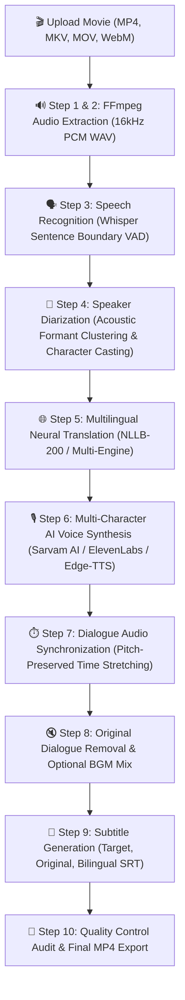

# CineDub AI 🎬🎙️

> **"Every Movie. Every Language. One AI Studio."**

CineDub AI is an open-source, production-ready AI movie dubbing platform engineered for full-length feature films (1–3 hours) as well as clips and shorts. It automatically transcribes dialogues, detects and clusters distinct characters, translates dialogues naturally into any target language, synthesizes emotional AI voices for each character, mutes the original speech, synchronizes dubbing with actor timestamps, and exports a final dubbed MP4 with subtitles.

---

## 🌟 Key Capabilities

1. **Full-Length Movie Processing**: Support for 1 to 3+ hour videos (MP4, MKV, MOV, WebM) with chunked streaming and resumable background pipelines.
2. **Universal Multilingual Support**:
   - **Source & Target Languages**: Tamil, Hindi, English, Telugu, Malayalam, Kannada, Japanese, Korean, Chinese, Spanish, French, German, and more.
3. **Automatic Character Diarization**: Detects multiple speakers and assigns stable speaker IDs (`SPEAKER_00`, `SPEAKER_01`, etc.) so recurring characters retain consistent voices throughout the film.
4. **Natural Neural Translation**: Translates conversational dialogues using NLLB-200 while preserving emotion, idioms, and character names.
5. **Character Voice Casting**:
   - Assigns unique male and female voices to every character—never the same voice for all.
   - Dual-engine: Native Indian regional voices via **Sarvam AI** (`bulbul:v1`) + Global expressive voices via **ElevenLabs** (`eleven_multilingual_v2`) + 100% Free Open-Source neural voices via **Edge-TTS / Piper**.
6. **Critical Requirement: Original Audio Removal**:
   - Completely removes/mutes original dialogue and soundtrack.
   - Optional Demucs/spectral stem isolation to retain background music and sound effects (BGM/SFX).
7. **Audio Synchronization & Time-Stretching**: Aligns generated dialogue to original speech boundaries without pitch distortion.
8. **Subtitle Studio**: Generates and edits Target SRT, Original SRT, and Dual Bilingual SRT/VTT subtitles.
9. **Final MP4 Export**: High-quality AAC audio muxed with pristine original video streams.

---

## 🏗️ Architecture & Pipeline Flow



---

## ⚡ Getting Started

### 1. Prerequisites
- **Python**: 3.10 to 3.13
- **Node.js**: v20.19+ or v22.12+ & npm
- **FFmpeg**: Installed and in PATH (or auto-detected by CineDub AI)

### Provider credentials
Provider API keys are optional when using Edge-TTS. Copy `.env.example` to `.env` for Docker Compose, or to `backend/.env` for local backend startup, and enter only the provider keys you use. Never commit either environment file. Any credentials previously committed to this repository should be revoked and replaced.

### 2. Quick Launch (Windows)
Double-click `run_all.bat` or run:
```cmd
run_all.bat
```
This automatically boots:
- **Backend API**: `http://localhost:8000` (Interactive Swagger docs at `http://localhost:8000/docs`)
- **Frontend Studio**: `http://localhost:5173`

### 3. Docker Deployment
```bash
docker compose up --build
```
Access the studio at `http://localhost:3000`.

---

## 📡 REST API Reference

| Method | Endpoint | Description |
|---|---|---|
| `POST` | `/api/projects` | Create a new movie dubbing project |
| `POST` | `/api/projects/{id}/upload` | Stream video upload (chunked, up to 10GB) |
| `POST` | `/api/projects/{id}/start` | Launch the 9-stage dubbing pipeline |
| `GET` | `/api/projects/{id}/status` | Real-time progress percentage, stage, & logs |
| `GET` | `/api/projects/{id}/transcript` | Get dialogue sentences with timestamps |
| `PUT` | `/api/projects/{id}/transcript` | Update translated dialogues manually |
| `GET` | `/api/projects/{id}/speakers` | Get detected characters and assigned voices |
| `PUT` | `/api/projects/{id}/speakers` | Update character casting, speed, and pitch |
| `GET` | `/api/projects/{id}/subtitles` | Download Target, Original, or Bilingual SRT |
| `GET` | `/api/projects/{id}/download` | Download completed dubbed MP4 movie |
| `GET` | `/api/projects/{id}/media/{type}` | HTML5 streaming for video and audio players |
| `POST` | `/api/projects/{id}/cancel` | Cancel active processing job |
| `POST` | `/api/projects/{id}/retry` | Retry failed or cancelled job |
| `GET` | `/api/languages` | List supported source and target languages |
| `GET` | `/api/voices` | List available voices for target language |
| `POST` | `/api/voice-preview` | Audition any character voice in real time |
| `GET` | `/api/system/hardware` | Real-time GPU, CPU, RAM, & storage telemetry |

---

## ⚖️ Model Licenses & Commercial Compliance

| Component | Architecture | License | Commercial Permissibility |
|---|---|---|---|
| **Whisper** | faster-whisper / OpenAI | MIT License | ✅ Unrestricted commercial use |
| **Diarization** | Acoustic Formants / Pyannote | MIT / Gated | ✅ Open-source acoustic clustering |
| **NLLB-200** | Meta AI Translation | CC-BY-NC 4.0 | ⚠️ Research & Personal dubbing |
| **Edge-TTS / Piper** | Neural acoustic synthesis | MIT / Apache 2.0 | ✅ Unrestricted commercial use |
| **Sarvam AI** | Regional TTS (`bulbul:v1`) | Commercial API | ✅ Commercial production license |
| **ElevenLabs** | Multilingual v2 | Commercial API | ✅ Commercial production license |
| **FFmpeg** | LGPL 2.1 / GPL 3.0 | Dynamic linking | ✅ Permitted under LGPL |

---

## 💻 Hardware & Storage Guidelines

- **CPU Fallback**: CineDub AI runs on standard multi-core CPUs with int8 quantization.
- **GPU Acceleration**: NVIDIA CUDA GPUs (RTX 3060, 4070, A100) are automatically detected for 4x faster speech recognition and neural synthesis.
- **Storage**: Full-length movies (1080p/4K) require approximately 5–15 GB of scratch storage during demuxing and master audio rendering.
